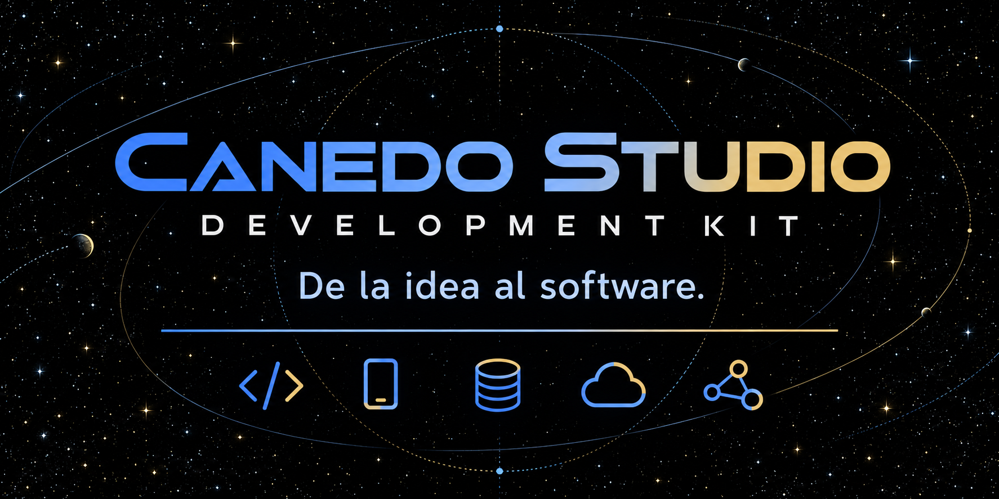

<div align="center">

# CANEDO STUDIO KIT

**De la idea al software.**

Skills · Plantillas · Arquitectura · Automatización

[Empezar](EMPIEZA-AQUI.md) · [Instalar](INSTALACION.md) · [Explorar ejemplos](#ejemplos-y-demos) · [Tutoriales](#tutoriales-y-documentacion) · [Skills](#catalogo-de-skills) · [Referencias](#referencias-externas)

</div>


Kit reutilizable para crear y rediseñar webs, desarrollar aplicaciones y preparar automatizaciones con un asistente de programación. Incluye skills, plantillas HTML/CSS/JS, scripts de validación y ejemplos de Cloudflare Workers.

**[Instalación](INSTALACION.md) · [Primeros pasos](EMPIEZA-AQUI.md) · [Capacidades y límites](docs/CAPACIDADES.md) · [REA, Clone Wars y AppFlowy](docs/REFERENCIAS-PRODUCTO.md)**

## Explora el kit

**KIT-FIRST:** los agentes integrados disponen de descubrimiento, inspección y generación con evidencias verificadas. Antes de generar, consultan el catálogo y evalúan módulos, autenticación, APIs y persistencia existentes. [Comandos, alcance y límites](docs/kit-first/README.md). La [memoria de proyectos](docs/continuity/README.md) registra estados versionados y permite mejoras incrementales revisadas de composiciones v1 sin reemplazar personalizaciones.

| Buscas | Empieza aquí |
|---|---|
| Probar una web incluida | [Ejemplos y demos](#ejemplos-y-demos) |
| Aprender a usar los comandos | [Tutoriales paso a paso](docs/GUIA-DEMOS.md) |
| Elegir una tecnología | [Catálogo de skills](#catalogo-de-skills) y [24 perfiles](config/kit-capabilities.json) |
| Encontrar una aplicación similar | [Clone Wars y referencias externas](#referencias-externas) |
| Combinar inventario, ventas y CRM | [Motor de composición](docs/PROJECT-COMPOSITION.md) y [ejemplo ejecutable](examples/composition/README.md) |
| Consultar el kit desde un agente | [KIT-FIRST y API CLI/JSON](docs/kit-first/README.md) |
| Conectar herramientas a un agente | [MCP STDIO y API estructurada](docs/integrations/agents.md), con ejemplos revisables |
| Elegir una solución comercial | [20 paquetes y sus estados](docs/commercial-packages/README.md) |
| Generar con otro lenguaje/persistencia | [Adaptadores y Python con SQLite/JSON](docs/composition/README.md) |
| Leer cómo funciona cada pieza | [Mapa de archivos](#mapa-de-archivos-y-codigo) |

## Planificación técnica universal — mejoras 1–3

La terminal prepara planes técnicos sin exigir módulos comerciales. Reutiliza el catálogo de 80 herramientas, el planificador de dependencias, las reglas de versiones, los diagnósticos, las recetas manuales y los preparadores de entorno existentes. No crea otro catálogo ni necesita cargar los generadores de los ejemplos.

```sh
node scripts/devkit.js plan "Crear una aplicación web con React y PostgreSQL" --json
node scripts/devkit.js plan "Crear una API con Python y FastAPI" --version python=3.14.4 --manager pip --json
node scripts/devkit.js plan "Crear una API con Python y FastAPI" --diagnose --json
npm run test:universal
```

Sin `--diagnose`, planificar no ejecuta procesos. Con esa opción se solicitan explícitamente consultas locales de versiones mediante el doctor existente; no instala ni arranca servicios. `--report /ruta/doctor.json` reutiliza un diagnóstico guardado, claramente marcado como aportado. Validar el plan no repite las consultas. La versión del ejemplo es una elección explícita, no una recomendación de versión reciente.

`technical-project-plan.resources` contiene herramientas y dependencias, conflictos, candidatos de perfiles/gestores, recetas y comandos manuales revisables. Con una versión exacta de runtime, puede preparar configuración de entorno **en memoria**; no escribe archivos ni instala los frameworks solicitados. Los conflictos bloquean esa preparación. No se seleccionan herramientas opcionales o un stack empresarial por defecto.

Las solicitudes explícitas de los ejemplos conservan su flujo anterior. `plan --technical` fuerza planificación consultiva para cualquier dominio. Los planes técnicos no pueden autorizar `create`. KIT-FIRST usa una huella del núcleo técnico y rechaza cambios de evidencia/destino, sin depender de paquetes comerciales deshabilitados. `ok` significa plan construido; no entorno listo, SDK probado o permiso de ejecución.

**Pruebas actuales:** 25/25 de planificación y recursos, 407/407 de regresión, sin fallos ni omisiones. Se verificó una consulta local de Python en macOS ARM64; Windows/Linux conservan pruebas simuladas.

**Verificación y límites:** [informe de mejoras 1–3](docs/reports/UNIVERSAL-IMPROVEMENTS-1-3.md) · [guía de uso](docs/cli/universal-planning.md). Las mejoras 4–8 incorporan reconocimiento técnico, continuidad estática y [eficiencia local con contexto progresivo](docs/cli/resource-efficiency.md). Los validadores nativos y clientes externos mantienen las limitaciones indicadas en esa guía. No se declaran conexiones reales ni compatibilidad nativa Windows/Linux por pruebas simuladas.

## Estado de la plataforma y navegación

KIT-FIRST es la entrada central: **consultar el kit → inspeccionar → reutilizar → planificar → validar → generar o mejorar**. El funcionamiento básico usa reglas en español y no requiere IA paga. No se reconstruyen proyectos ni se duplica autenticación por preferencia de stack.

| Capacidad | Estado real | Documentación/código |
|---|---|---|
| Terminal en español, descubrimiento y generación segura | Plan técnico universal consultivo; generación acotada a los adaptadores existentes | [CLI](docs/cli/README.md), [KIT-FIRST](docs/kit-first/README.md) |
| Codex y agentes | API/MCP STDIO probado con cliente de protocolo; configuración de clientes reales pendiente | [Integración y ejemplos](docs/integrations/agents.md) |
| Memoria y continuación | Manifiesto versionado; reconciliación v1 probada con personalizaciones | [Continuidad](docs/continuity/README.md) |
| Generadores de negocio | Node v1, Python inventario SQLite/JSON y business v2; otros stacks requieren adaptador | [Arquitectura/extensiones](docs/architecture/README.md), [composición](docs/composition/README.md) |
| 25 capacidades de composición | Código inicial de comercio/CRM/SaaS y preparación comercial; no 25 productos completos | [Registro](catalog/composition/registry.json) |
| 20 paquetes comerciales | 14 parciales y 6 planificados; ninguno declarado producto completo | [Paquetes/estados](docs/commercial-packages/README.md) |
| CRM omnicanal | Backend local persistente, roles y bandeja mínima; sin canales reales verificados | [Canales y límites](docs/integrations/omnichannel.md) |
| SaaS y combinaciones A–I | Planes/cuotas locales; preparación de pedidos/campañas/documentos | [SaaS y monetización](docs/monetization/README.md) |
| Docker y herramientas | Diagnóstico independiente y comandos/archivos revisables; sin instalaciones automáticas | [Operaciones](docs/WORKSPACE-OPERATIONS.md), [recetas manuales](docs/COMMAND-INSTALLATION.md) |
| Seguridad y pruebas | Aislamiento, permisos, procedencia y regresiones locales; producción pendiente | [Seguridad](docs/security/README.md), [prueba/tutorial integral](docs/tutorials/tienda-saas.md) |

Los lenguajes/frameworks de las skills incluyen React/Next.js, Vue, Angular, Go, Java, .NET/C#, Python, PHP/Laravel, Android/React Native, C/C++/Arduino y Terraform/Pulumi. Las guías de SQL contemplan PostgreSQL, MySQL/MariaDB, SQLite, SQL Server y Oracle. **Guía, diagnóstico, starter y generador de negocio son niveles distintos de soporte**; consultar [capacidades](docs/CAPACIDADES.md) antes de elegir. No se afirma compilación o aplicación completa para todos ellos.

### Pruebas y ejemplo integrado

```sh
npm run kit:validate
npm run test:kit
npm run kit:composition -- acceptance --json
```

Evidencia histórica de las ocho etapas: **382/382 pruebas de regresión** y **52/52 pruebas agrupadas de aceptación** en macOS ARM64 con Node v25.2.1. [Evidencia](docs/reports/KIT-EVOLUTION-ACCEPTANCE-MACOS-ARM64.json). Windows/Linux y canales reales no se verificaron. La aceptación explícita genera A–I y una tienda SaaS en destinos temporales, valida contratos/Compose, ejecuta SQLite/HTTP y registra pruebas locales en memoria. Demuestra productos, inventario, compras, venta, caja, CRM y chatbot simulado. No instala herramientas, ejecuta Docker ni conecta servicios de pago. [Tutorial reproducible](docs/tutorials/tienda-saas.md) · [Informes por etapa](docs/reports/KIT-EVOLUTION-INDEX.md).

### Pendientes y contribuciones

Roadmap: reconciliadores v2/Python que preserven datos y personalizaciones; identidad de producción/OIDC; paginación/retención y paneles completos; permisos y pruebas autorizadas de canales; delivery/plantillas/recordatorios; proveedores IA/pagos/facturación; backups/HA y verificación nativa Windows/Linux. TikTok permanece bloqueado mientras acceso/contrato no estén verificados. Los adaptadores simulados no se presentan como integración terminada.

Para contribuir, extender catálogos/esquemas y adaptadores revisados, agregar pruebas y actualizar estados antes de anunciar soporte. Revisar [arquitectura](docs/architecture/README.md), [seguridad](docs/security/README.md) y licencias/procedencia de cada recurso. No incorporar proyectos privados, credenciales o código externo sin permiso. REA, Clone Wars, AppFlowy, AFPVentas y Vocero son referencias con alcances diferentes; no constituyen dependencias instaladas ni licencias universales.

## Descargar y empezar

```bash
git clone https://github.com/luisfor/Canedo-Web-Studio.git
cd Canedo-Web-Studio
npm ci
npm run kit:catalog
npm run kit:validate
```

Abre la carpeta en tu asistente. Codex descubre las skills de `.agents/skills/`; Claude Code dispone de las skills originales de `.claude/skills/` y del enrutamiento de `CLAUDE.md`. Para instalar las skills nuevas como skills nativas de otro agente, usa las opciones de [INSTALACION.md](INSTALACION.md).

El kit aporta instrucciones y herramientas de desarrollo: **no instala automáticamente SDKs, bases de datos, brokers, AppFlowy ni el servidor MCP de REA**. Cada proyecto requiere sus dependencias y pruebas. No se promete que todas las plataformas estén verificadas por instalar una skill.

## Componer una tienda con CRM y chatbot

La [terminal inteligente](docs/cli/README.md) admite `plan`, `create`, `enhance` e `inspect` mediante `node scripts/devkit.js` o `npm run devkit -- ...`. Interpreta español localmente, exige KIT-FIRST y muestra preguntas o módulos faltantes. No instala un comando global ni presenta canales/suscripciones pendientes como disponibles.

El motor interpreta solicitudes en español, consulta el catálogo de proyectos/capacidades y genera código original con módulos, endpoints, persistencia SQLite, migraciones, contratos OpenAPI, eventos, pruebas y Compose opcional. El ejemplo integra venta → inventario → caja → CRM. WhatsApp y chatbot permanecen deshabilitados hasta configurar explícitamente adaptadores; las pruebas usan proveedores simulados identificados como tales.

```bash
npm run kit:composition -- plan --request "inventario, ventas, caja, CRM de WhatsApp y chatbot" --docker --json
npm run test:composition
npm run kit:composition -- verify --json
```

`plan` solo muestra el resultado. `verify` es una prueba explícita con SQLite temporal y HTTP en localhost; no inicia contenedores. Los generadores de negocio ejecutables son Node/SQLite v1, Node/SQLite business v2 y Python/inventario con SQLite o JSON-file. Las demás tecnologías requieren un generador compatible y no se migran silenciosamente. Elige monolito modular por defecto y servicios independientes cuando estén justificados. AFPVentas y Vocero son referencias de arquitectura, sin importar su código. No se sobrescriben destinos existentes.

[Tutorial para generar el proyecto](examples/composition/README.md) · [Arquitectura y extensiones](docs/PROJECT-COMPOSITION.md) · [Catálogo](catalog/composition/registry.json) · [Informe de pruebas](docs/reports/PROJECT-COMPOSITION.md)

## Qué puede ayudarte a construir

| Área | Recursos incluidos |
|---|---|
| Webs de negocios | Rediseño, branding, landing pages, propuestas comerciales y plantilla estática |
| Frontend | Skill para React, Vue y Angular: componentes, formularios, rutas, estado y APIs |
| Backend | Skill para Java, C#/.NET y Python: APIs, persistencia, trabajos y autenticación |
| Móvil | Skill para Android Java/Kotlin, React Native y Flutter; guía para componentes Rust de AppFlowy |
| Sistemas y hardware | Skill para C, C++, Arduino, memoria, protocolos y validación de firmware |
| Datos | Skill para SQL, SQL Server, SQLite, PostgreSQL, MySQL y Oracle |
| Arquitectura y CRM | Modelado, permisos, organizaciones, pipeline comercial, auditoría y contratos |
| Workspace | Procedimientos para documentos por bloques, wikis, tablas, kanban, offline y colaboración |
| DevOps | Skill de CI/CD, contenedores, observabilidad, Terraform y Pulumi |
| Trading cuantitativo | Investigación, backtesting, costes, simulación y controles de riesgo; sin promesas de rentabilidad |
| Referencias | Evaluación de proyectos de Clone Wars y de AppFlowy; ruta para complementarlos con REA |
| Ingeniería inversa | Skill original REA con siete referencias y licencia MIT; herramientas externas opcionales |
| IA y diseño | Generación/búsqueda de imágenes según proveedor y pipeline Design-to-Web; integración de chatbots con backend privado |
| Publicación | Guías para Cloudflare Pages/Workers y Hostinger; infraestructura full-stack y móvil separada |
| Marketing | Skills de SEO, blog automático y reseñas; ejemplos de bots sociales y agente comercial |

Son **14 skills en `.agents/skills/` y 24 perfiles de herramientas**. Los perfiles son rutas de trabajo y detección de CLIs; no son 24 aplicaciones ya implementadas. El catálogo en `config/kit-capabilities.json` identifica sus nombres y requisitos.

## Catálogo versionado de herramientas

Consulta [las 80 entradas del catálogo](docs/TOOL-CATALOG.md): runtimes, SDKs, gestores, clientes y servidores de datos, infraestructura, calidad y paquetes de proyecto. **22 entradas tienen diagnóstico y 58 están documentadas**; no son 80 herramientas instaladas ni verificadas en todos los sistemas.

La fase C añade dependencias obligatorias/opcionales, validación de conflictos y reglas de versión con fuentes. El doctor aplica las reglas declaradas de Node, Python y Go; el resto queda sin evaluar hasta definir requisitos concretos. No instala ni actualiza nada.

La fase D incorpora un [planificador revisable](docs/INSTALLATION-PLANNER.md): resuelve dependencias, detecta bloqueos y propone reutilizar, inspeccionar o instalar. Mantiene las decisiones pendientes explícitas y no ejecuta cambios.

```bash
npm run kit:plan -- --tool go --json
npm run kit:plan -- validate --file plan.json --json
```

```bash
npm run kit:tools -- list --kind database-client
npm run kit:tools -- dependencies govulncheck --json
npm run kit:tools -- validate
```

## Comandos revisables por sistema — fase E

El kit trabaja en **modo manual**: genera comandos y tú los revisas y ejecutas. El modo asistido está reservado y deshabilitado. No se ejecutan instalaciones, cambios globales ni `install apply` desde el CLI o el API público.

Hay adaptadores Homebrew, winget, apt, dnf y archivos oficiales. Las recetas manuales iniciales cubren Node/npm, Go, Python, Git, Java, .NET, Terraform y Docker. El plan muestra versiones, paquetes, fuentes, dependencias, permisos, espacio conocido o sin estimar, riesgos y verificación. Conserva herramientas compatibles; una herramienta preexistente que requiere revisión no recibe comandos de reinstalación nativa.

```bash
npm run kit:install -- modes --json
npm run kit:install -- coverage
node scripts/kit.js install commands --plan go-plan.local.json --method homebrew
```

Consulta [el uso de comandos manuales](docs/COMMAND-INSTALLATION.md), [la transición de las recetas anteriores](docs/TOOL-INSTALLERS.md) y [el informe de la fase E](docs/reports/PHASE-E-MANUAL.md). Se conservan 14 skills, 24 perfiles, 80 herramientas y los snapshots oficiales anteriores. La cobertura manual es 8 herramientas con receta, npm incluido y 71 sin receta. El diagnóstico operativo, las versiones por proyecto y las plantillas/operaciones de Docker están disponibles en las fases F–I descritas abajo. Windows/Linux tienen pruebas simuladas y una matriz CI preparada, sin certificación nativa en esta sesión.

## Entornos y Docker — fases F–I

El kit diagnostica Docker CLI, servidor Engine, presencia de Desktop, Compose y Buildx por separado. Puede generar archivos de versiones/dependencias para Node, Python, Go, Java, .NET y Rust en carpetas nuevas, sin sobrescribir proyectos o configurar globalmente el equipo.

Incluye diez perfiles optativos y plantillas Compose para PostgreSQL, MariaDB, MySQL, MongoDB, Redis y backends /health de Node/Python/Go/Java/.NET, con secretos externos, persistencia, health checks, límites y puertos cerrados por defecto. Los comandos de iniciar/detener/inspeccionar/mantener se muestran para ejecución manual; acciones destructivas exigen confirmaciones particulares. Exportar/restaurar reproduce configuración inicial, no secretos, datos o código modificado.

```bash
npm run kit:docker -- doctor --server --json
npm run kit:profiles -- list
npm run kit:project -- plan --stack go --version 1.27.3 --json
npm run kit:docker -- plan --name demo --service postgres --image postgres=postgres:17.6 --json
npm run kit:verify -- runtime --json
```

Consulta la [guía con flujos completos](docs/WORKSPACE-OPERATIONS.md) y el [informe F–I](docs/reports/PHASES-F-I.md). El backend de ejemplo no implementa una aplicación completa. No se ejecuta Docker para generar archivos ni se descargan imágenes automáticamente. Docker está ausente en el host de esta entrega; los contenedores/builds y la matriz Windows/Linux/macOS Intel requieren verificación real posterior. La [matriz CI](.github/workflows/kit-validation.yml) está definida, no ejecutada aquí. La [ampliación I](docs/reports/PHASE-I.md) ejecutó HTTP nativo en Node/Python/Java sobre macOS ARM64: 301 pruebas de suite y 25 controles, sin instalar herramientas. El esquema oficial valida Compose sin motor, pero no certifica contenedores.

## Cómo se complementan los repositorios

- **REA:** mejor para investigar paquetes, binarios y comportamiento en ejecución que no esté explicado por fuentes completas.
- **Clone Wars:** mejor como índice para encontrar ejemplos y alternativas con código; hay demos educativas y proyectos más completos. Revisa cada candidato.
- **AppFlowy:** mejor referencia de los tres para documentos, tablas y colaboración; es una aplicación Flutter/Rust con licencia AGPLv3, no un plugin REA.

Esta comparación describe para qué usar cada uno; no existe un ganador para todas las tareas. El kit añade procedimientos propios de selección y construcción. No incluye una copia del catálogo de Clone Wars ni del código de AppFlowy. Consulta [fuentes y alcance](docs/REFERENCIAS-PRODUCTO.md).

## Comandos del kit

```bash
npm run kit:catalog
npm run kit:tools -- list
npm run kit:tools -- show go --json
npm run kit:catalog -- --profile react --json
npm run kit:doctor -- --profile react
npm run kit:doctor -- --profile dotnet --strict
npm run kit:validate
npm run test:kit
```

`doctor` informa del sistema, arquitectura, versiones de CLIs y gestores detectados. Conserva `--profile`, `--json` y `--strict`; también admite `--tool git --tool go`. No instala ni actualiza herramientas. Aplica las reglas explícitas del catálogo; la compatibilidad queda sin evaluar cuando no existe una regla; los gestores se detectan por presencia. Consulta [el diagnóstico de entorno y sus límites](docs/ENVIRONMENT-DOCTOR.md). Windows y Linux tienen pruebas simuladas; su ejecución nativa está pendiente.

### Herramientas existentes para webs

```bash
npm run new-site
npm run validate -- mi-cliente
npm run verify-production -- https://example.com
npm run design-to-web:analyze -- tests/design-to-web/simple-landing.png mi-proyecto
```

Consulta el contrato exacto de los scripts en [Design-to-Web](docs/DESIGN-TO-WEB.md), [lista de entrega](docs/NEW-SITE-CHECKLIST.md) y [depuración](docs/DEBUGGING.md). La plantilla estática y su despliegue no sustituyen un servidor para Java, .NET o Python ni un build móvil.

## Ejemplos de peticiones

- «Crea una web para una clínica con sus datos reales y prepara una propuesta».
- «Construye un CRM en Vue, Java y PostgreSQL con aislamiento entre empresas».
- «Añade una API en C#/.NET con SQL Server al proyecto existente».
- «Compara referencias de Clone Wars para un marketplace en React».
- «Diseña un workspace con documentos y kanban tomando AppFlowy como referencia».
- «Implementa una app Android o React Native que funcione sin conexión».
- «Programa este sensor Arduino; indica qué necesitas saber de la placa».
- «Prepara Terraform o Pulumi para este entorno y muestra el plan».
- «Evalúa una estrategia en Python con datos históricos, costes y periodo fuera de muestra».

La skill de trading ayuda a desarrollar software y estudiar hipótesis. No instala un broker, no garantiza resultados y no envía órdenes reales por defecto.

## Automatismos y recursos existentes

- [Blog automático](automatismos/README.md): Worker, KV, generación de artículos/portadas y notificaciones opcionales; requiere recursos propios.
- [Bot social](automatismos/social-media-bot/README.md): código de generación de contenido y revisión con Telegram; configura proveedores y almacenamiento.
- [Agente comercial](automatismos/canedostudio-sales-agent/README.md): ejemplo con D1 y conversaciones; su README documenta adaptadores y pasos pendientes. No se considera producción lista por copiarlo.
- [Reseñas](componente-resenas.md): carrusel de testimonios y formulario de valoración; usa reseñas reales y verifica políticas vigentes del proveedor antes de publicar flujos de solicitud.
- [Propuesta](plantilla-propuesta.md), [plantilla de valoración](plantilla-calificanos.html), [despliegue](despliegue.md), [rendimiento](docs/PERFORMANCE.md), [diseño](docs/PREMIUM-DESIGN-SYSTEM.md), [datos estructurados](docs/STRUCTURED-DATA.md).

## Ejemplos y demos

| Proyecto o recurso | Código / archivo | Demo | Tutorial | Tecnología / estado |
|---|---|---|---|---|
| Restaurante ficticio para practicar rediseño | [HTML y recursos](ejemplos/web-de-practica/) | [Abrir localmente](docs/GUIA-DEMOS.md#ver-las-demos-locales) | [Cómo practicar](ejemplos/LEEME.md) | HTML/SVG; ejemplo con fallos intencionales |
| Starter de web de negocio | [Plantilla](starter-template/) | [Vista local](docs/GUIA-DEMOS.md#ver-las-demos-locales) | [Crear y validar](docs/GUIA-DEMOS.md#crear-y-validar-una-web) | HTML/CSS/JS; personalizar antes de entregar |
| Design-to-Web | [Pipeline](scripts/design-to-web/) · [Entrada de ejemplo](tests/design-to-web/simple-landing.png) | [Fixtures y pruebas](tests/design-to-web/) | [Guía](docs/DESIGN-TO-WEB.md) · [Límites del mock](docs/GUIA-DEMOS.md#design-to-web) | Analizador, builder y QA; proveedor real opcional |
| Testimonios y valoración | [Plantilla HTML](plantilla-calificanos.html) | No hay demo pública publicada | [Componente y adaptación](componente-resenas.md) | Plantilla; revisar datos y políticas antes de activar envíos |
| Blog automático | [Worker de referencia](automatismos/ejemplo-blog-bot/) | Requiere recursos propios | [Receta de instalación](automatismos/README.md) | Cloudflare Worker/KV/AI; integración externa |
| Bot de redes sociales | [Fuentes](automatismos/social-media-bot/) | Requiere configuración | [Arquitectura y uso](automatismos/social-media-bot/README.md) | Worker, IA, Telegram, D1 y R2 |
| Agente comercial | [Fuentes](automatismos/canedostudio-sales-agent/) | Adaptadores y credenciales pendientes según su README | [Estado y requisitos](automatismos/canedostudio-sales-agent/README.md) | Worker, Gemini, Instagram y D1 |
| Automatismos n8n | [Carpeta de flujos](automatismos/n8n/) | Depende del flujo y la instancia | [Guía](automatismos/n8n/README.md) | No equivale a n8n instalado |

Las demos locales se sirven en tu equipo; GitHub muestra el código de los HTML. No se incluyen datos ni demos privadas de clientes.

## Referencias externas

| Referencia | Repositorio | Demos / producto | Tutoriales y documentación | Relación con el kit |
|---|---|---|---|---|
| Clone Wars | [Código e índice original](https://github.com/GorvGoyl/Clone-Wars) | [Tabla de clones y alternativas](https://github.com/GorvGoyl/Clone-Wars#clones-and-alternatives) | [Proyectos con tutoriales](https://github.com/GorvGoyl/Clone-Wars#clones-with-tutorials) | Fuente de ejemplos; revisar licencia y requisitos de cada proyecto |
| REA | [Repositorio](https://github.com/morluto/rea) | [Casos de uso](https://rea.tools/showcase/) | [Guías](https://rea.tools/guides/) · [Instalación](https://github.com/morluto/rea/blob/main/docs/installation.md) | Skill incluida; servidor MCP separado |
| AppFlowy | [Repositorio](https://github.com/AppFlowy-IO/AppFlowy) | [Producto y capturas](https://github.com/AppFlowy-IO/AppFlowy#readme) · [Releases](https://github.com/AppFlowy-IO/AppFlowy/releases) | [Desarrollo desde fuentes](https://docs.appflowy.io/docs/documentation/appflowy/from-source) | Referencia de workspace Flutter/Rust; no instalado |

Los enlaces externos llevan a sus autores; no son tutoriales ni demos mantenidos por Canedo Studio. El catálogo completo de Clone Wars permanece en su fuente original.

**Flujo propuesto para agilizar entregas:** pedir una aplicación → sugerir un ejemplo similar → obtener aceptación → revisar licencia y dependencias → descargar una copia independiente → adaptar → probar → entregar. El descargador y la biblioteca de bases verificadas están pendientes de implementación y de la fase de auditoría acordada.

<a id="catalogo-de-skills"></a>

## Catálogo de skills

| Skill / archivo | Qué aporta | Guía o punto de entrada |
|---|---|---|
| [arquitecto-fullstack](.agents/skills/arquitecto-fullstack/SKILL.md) | Arquitecturas, SaaS y CRM | [Leer instrucciones](.agents/skills/arquitecto-fullstack/SKILL.md) |
| [referencias-producto](.agents/skills/referencias-producto/SKILL.md) | Evaluación de Clone Wars y complemento de REA | [Leer instrucciones](.agents/skills/referencias-producto/SKILL.md) |
| [workspace-colaborativo](.agents/skills/workspace-colaborativo/SKILL.md) | Documentos, wikis, kanban y evaluación de AppFlowy | [Leer instrucciones](.agents/skills/workspace-colaborativo/SKILL.md) |
| [desarrollo-frontend](.agents/skills/desarrollo-frontend/SKILL.md) | React, Vue y Angular | [Leer instrucciones](.agents/skills/desarrollo-frontend/SKILL.md) |
| [desarrollo-backend](.agents/skills/desarrollo-backend/SKILL.md) | Java, C#/.NET y Python | [Leer instrucciones](.agents/skills/desarrollo-backend/SKILL.md) |
| [desarrollo-movil](.agents/skills/desarrollo-movil/SKILL.md) | Android, React Native y Flutter | [Leer instrucciones](.agents/skills/desarrollo-movil/SKILL.md) |
| [sistemas-embebidos](.agents/skills/sistemas-embebidos/SKILL.md) | C, C++ y Arduino | [Leer instrucciones](.agents/skills/sistemas-embebidos/SKILL.md) |
| [bases-datos](.agents/skills/bases-datos/SKILL.md) | SQL y cinco motores relacionales | [Leer instrucciones](.agents/skills/bases-datos/SKILL.md) |
| [devops-iac](.agents/skills/devops-iac/SKILL.md) | DevOps, Terraform y Pulumi | [Leer instrucciones](.agents/skills/devops-iac/SKILL.md) |
| [trading-cuantitativo](.agents/skills/trading-cuantitativo/SKILL.md) | Backtesting, simulación y software de trading | [Leer instrucciones](.agents/skills/trading-cuantitativo/SKILL.md) |
| [reverse-engineer-anything](.agents/skills/reverse-engineer-anything/SKILL.md) | Investigación con REA; MCP externo | [Leer instrucciones](.agents/skills/reverse-engineer-anything/SKILL.md) |
| [robot-contenidos](.agents/skills/robot-contenidos/SKILL.md) | Automatización de artículos | [Leer instrucciones](.agents/skills/robot-contenidos/SKILL.md) |
| [seo-auditor](.agents/skills/seo-auditor/SKILL.md) | Auditorías SEO | [Leer instrucciones](.agents/skills/seo-auditor/SKILL.md) |
| [slider-resenas](.agents/skills/slider-resenas/SKILL.md) | Testimonios y componentes de reseñas | [Leer instrucciones](.agents/skills/slider-resenas/SKILL.md) |
| [luis-estudio-web](.claude/skills/luis-estudio-web/SKILL.md) | Diseño, imágenes y publicación de webs | [Brief de proyecto](.claude/skills/luis-estudio-web/intake-template.md) |
| [luis-rediseño-premium](.claude/skills/luis-rediseño-premium/SKILL.md) | Análisis y rediseño de webs de negocios | [Ejercicio de práctica](ejemplos/LEEME.md) |

<a id="tutoriales-y-documentacion"></a>

## Tutoriales y documentación

| Archivo | Para qué sirve |
|---|---|
| [EMPIEZA-AQUI.md](EMPIEZA-AQUI.md) | Primeros pasos |
| [INSTALACION.md](INSTALACION.md) | Descarga, instalación y selección de skills |
| [docs/GUIA-DEMOS.md](docs/GUIA-DEMOS.md) | Demos locales y tutoriales de comandos |
| [docs/ENVIRONMENT-DOCTOR.md](docs/ENVIRONMENT-DOCTOR.md) | Diagnóstico de OS, herramientas, gestores y límites de la fase B |
| [docs/WORKSPACE-OPERATIONS.md](docs/WORKSPACE-OPERATIONS.md) | Versiones por proyecto, perfiles, Docker, operación, exportación y verificación |
| [docs/reports/PHASES-F-I.md](docs/reports/PHASES-F-I.md) | Resultados y límites de las fases F–I, con enlaces por fase |
| [docs/COMMAND-INSTALLATION.md](docs/COMMAND-INSTALLATION.md) | Adaptadores, comandos, versiones, precondiciones, Docker y límites de la fase E |
| [docs/reports/PHASE-E-MANUAL.md](docs/reports/PHASE-E-MANUAL.md) | Archivos, pruebas, resultados, riesgos y pendientes de esta entrega |
| [docs/TOOL-INSTALLERS.md](docs/TOOL-INSTALLERS.md) | Modo manual, snapshots conservados y transición sin ejecución |
| [docs/INSTALLATION-PLANNER.md](docs/INSTALLATION-PLANNER.md) | Uso, decisiones, integridad y límites del planificador de la fase D |
| [docs/TOOL-CATALOG.md](docs/TOOL-CATALOG.md) | Catálogo versionado, dependencias, reglas y límites de la fase C |
| [CHANGELOG.md](CHANGELOG.md) | Cambios del kit |
| [docs/CAPACIDADES.md](docs/CAPACIDADES.md) | Capacidades reales, perfiles y límites |
| [docs/REFERENCIAS-PRODUCTO.md](docs/REFERENCIAS-PRODUCTO.md) | Comparación, procedencia y licencias de referencias |
| [docs/DESIGN-TO-WEB.md](docs/DESIGN-TO-WEB.md) | Pipeline de diseño a HTML/CSS/JS |
| [docs/CLOUDFLARE.md](docs/CLOUDFLARE.md) | Cloudflare |
| [docs/DEBUGGING.md](docs/DEBUGGING.md) | Diagnóstico y resolución de fallos |
| [docs/NEW-SITE-CHECKLIST.md](docs/NEW-SITE-CHECKLIST.md) | Lista de entrega de webs |
| [docs/PERFORMANCE.md](docs/PERFORMANCE.md) | Rendimiento web |
| [docs/PREMIUM-DESIGN-SYSTEM.md](docs/PREMIUM-DESIGN-SYSTEM.md) | Sistema de diseño |
| [docs/STRUCTURED-DATA.md](docs/STRUCTURED-DATA.md) | Datos estructurados y SEO |
| [despliegue.md](despliegue.md) | Publicar y actualizar una web |
| [componente-resenas.md](componente-resenas.md) | Componentes de testimonios y valoración |
| [plantilla-propuesta.md](plantilla-propuesta.md) | Propuesta comercial editable |
| [automatismos/n8n/arquitectura-shorts-multiagente.md](automatismos/n8n/arquitectura-shorts-multiagente.md) | Diseño documentado de automatización de contenido |

<details>
<summary>Ver todas las guías especializadas de diseño, imágenes, compatibilidad y despliegue</summary>

- [01-stack-and-conventions](.claude/skills/luis-estudio-web/reference/01-stack-and-conventions.md)
- [02-archetypes](.claude/skills/luis-estudio-web/reference/02-archetypes.md)
- [03-effects-catalog](.claude/skills/luis-estudio-web/reference/03-effects-catalog.md)
- [04-critical-gotchas](.claude/skills/luis-estudio-web/reference/04-critical-gotchas.md)
- [05-image-and-asset-pipeline](.claude/skills/luis-estudio-web/reference/05-image-and-asset-pipeline.md)
- [06-diversity-guardrails](.claude/skills/luis-estudio-web/reference/06-diversity-guardrails.md)
- [07-windows-troubleshooting](.claude/skills/luis-estudio-web/reference/07-windows-troubleshooting.md)
- [08-pre-deploy-checklist](.claude/skills/luis-estudio-web/reference/08-pre-deploy-checklist.md)
- [09-environment-detection](.claude/skills/luis-estudio-web/reference/09-environment-detection.md)
- [10-deployment-and-cache](.claude/skills/luis-estudio-web/reference/10-deployment-and-cache.md)
- [11-ai-image-generation](.claude/skills/luis-estudio-web/reference/11-ai-image-generation.md)
- [12-hostinger-connect](.claude/skills/luis-estudio-web/reference/12-hostinger-connect.md)
- [13-hostinger-deploy](.claude/skills/luis-estudio-web/reference/13-hostinger-deploy.md)
- [14-cloudflare-deploy](.claude/skills/luis-estudio-web/reference/14-cloudflare-deploy.md)

</details>

<details>
<summary>Ver las siete guías técnicas incluidas de REA</summary>

- [android-applications](.agents/skills/reverse-engineer-anything/references/android-applications.md)
- [connection-and-recovery](.agents/skills/reverse-engineer-anything/references/connection-and-recovery.md)
- [environments](.agents/skills/reverse-engineer-anything/references/environments.md)
- [evidence-workflows](.agents/skills/reverse-engineer-anything/references/evidence-workflows.md)
- [javascript-applications](.agents/skills/reverse-engineer-anything/references/javascript-applications.md)
- [native-and-artifacts](.agents/skills/reverse-engineer-anything/references/native-and-artifacts.md)
- [runtime-observation](.agents/skills/reverse-engineer-anything/references/runtime-observation.md)

</details>

<a id="mapa-de-archivos-y-codigo"></a>

## Mapa de archivos y código

| Ruta | Contenido |
|---|---|
| [AGENTS.md](AGENTS.md) · [CLAUDE.md](CLAUDE.md) | Instrucciones y selección de skills |
| [.agents/skills/](.agents/skills/) · [.claude/skills/](.claude/skills/) | Skills y sus referencias |
| [config/kit-capabilities.json](config/kit-capabilities.json) | Catálogo de 14 skills y 24 perfiles |
| [catalog/tools/manifest.json](catalog/tools/manifest.json) · [schemas/tool-catalog.schema.json](schemas/tool-catalog.schema.json) | Catálogo de herramientas y su esquema |
| [scripts/tools/catalog.js](scripts/tools/catalog.js) | Consultas y validación semántica del catálogo |
| [scripts/kit.js](scripts/kit.js) · [scripts/doctor/](scripts/doctor/) | Catálogo, diagnóstico de entorno y validación |
| [scripts/new-site.js](scripts/new-site.js) | Generador de sitios desde el starter |
| [scripts/validate.js](scripts/validate.js) | Validación de recursos y estructura web |
| [scripts/verify-production.js](scripts/verify-production.js) | Comprobaciones de una web publicada |
| [scripts/design-to-web/](scripts/design-to-web/) | Analizador, esquema, builder, componentes y QA |
| [tests/kit/](tests/kit/) · [tests/design-to-web/](tests/design-to-web/) | Pruebas y fixtures; sin afirmar CI público configurado |
| [starter-template/](starter-template/) · [ejemplos/](ejemplos/) | Plantilla estática y práctica |
| [automatismos/](automatismos/) | Bots y recetas de integración |
| [package.json](package.json) · [.env.example](.env.example) | Comandos/dependencias y nombres de variables de ejemplo |
| [.agents/plugins/n8n-skills/](.agents/plugins/n8n-skills/) | Plugin incluido con documentación y licencias propias |

## Privacidad, costes y licencias

Usa tus propias cuentas y claves. Guarda secretos en variables privadas o un gestor de secretos, nunca en código que se entregue al navegador. `.env`, `secretos/`, configuraciones locales y trabajos en `cazas/` están excluidos; revisa Git antes de publicar.

Los precios y cuotas dependen del proveedor y cambian. El kit no garantiza coste cero, facturación ni resultados comerciales. Cada SDK/servicio requiere verificar requisitos actuales y la autorización del entorno de destino.

REA conserva su [licencia MIT](.agents/skills/reverse-engineer-anything/LICENSE). Otros componentes conservan sus avisos; [referencias y procedencia](docs/REFERENCIAS-PRODUCTO.md). No supongas que todos los proyectos enlazados por un catálogo comparten una licencia.

El planificador está en [scripts/planner/plan.js](scripts/planner/plan.js), con [esquema de planes](schemas/tool-plan.schema.json), [esquema de diagnóstico de entrada](schemas/diagnostic-report.schema.json) y [pruebas](tests/kit/planner.test.js).

Instaladores: [registro y cobertura](scripts/installers/index.js), [Go](scripts/installers/go.js), [recetas Node/Terraform](scripts/installers/archive-recipes.js), [motor de archivos](scripts/installers/archive-engine.js), [operaciones compartidas](scripts/installers/filesystem.js), [transporte HTTPS](scripts/installers/transport.js), [pruebas Go](tests/kit/installers.test.js) y [pruebas Node/Terraform](tests/kit/archive-installers.test.js).

Comandos manuales: [recetas](catalog/install-recipes/manifest.json), [esquema de recetas](schemas/install-recipes.schema.json), [catálogo](scripts/commands/catalog.js), [generador](scripts/commands/plan.js), [renderizador](scripts/commands/render.js), [política de modos](scripts/commands/policy.js), [esquema de plan](schemas/command-plan.schema.json), [cargador del esquema](scripts/commands/schema.js) y [pruebas](tests/kit/manual-commands.test.js).

Módulos F–I: [perfiles](catalog/profiles/manifest.json), [Docker](scripts/docker/), [proyectos/entornos](scripts/workspace/), [pruebas F](tests/kit/workspace-f.test.js), [G](tests/kit/workspace-g.test.js), [H](tests/kit/workspace-h.test.js), [I](tests/kit/workspace-i.test.js) y [workflow](.github/workflows/kit-validation.yml).

Verificación I ampliada: [pruebas nativas](scripts/workspace/native-check.js), [parser Compose disponible](scripts/workspace/compose-check.js), [validador de esquema](scripts/docker/schema.js), [esquema/licencia/procedencia](schemas/vendor/), [plantillas anteriores](scripts/docker/backends-v1.js), [pruebas](tests/kit/native-i.test.js), [evidencia local](docs/reports/PHASE-I-NATIVE-MACOS-ARM64.json) e [inventario revisable de CI](docs/reports/PHASE-I-CI-FILES.json).

### CRM omnicanal local — etapa 6

El arquetipo `node-business` amplía el backend con conversaciones, embudos, etiquetas/segmentación, asignaciones, transferencia a humano, conocimiento, respuestas rápidas, citas con control de solapamiento, roles y auditoría. Reutiliza comercio y CRM; conserva la familia v1 sin migrarla. Incluye bandeja web mínima.

```sh
node scripts/devkit.js plan "Crear tienda CRM omnicanal WhatsApp Facebook Instagram chatbot agenda" --out /ruta/nueva/tienda --json
```

Los adaptadores de canales están deshabilitados por defecto. Se prueba recepción Meta firmada con fixtures locales; no hay envío externo ni verificación real de cuentas. TikTok queda bloqueado por acceso/especificación sin verificar. Chatbot simulado solo con inyección autorizada. [Guía](docs/integrations/omnichannel.md) · [Informe de etapa 6](docs/reports/KIT-EVOLUTION-STAGE-6.md).

### SaaS y combinaciones — etapa 7

Generación local con planes/suscripciones administrados por operador, cuotas mensuales UTC, alertas y auditoría por empresa. No procesa cobros. Los comandos `npm run kit:packages -- combinations --json` y `npm run kit:packages -- combination --name H --docker --json` consultan las combinaciones A–I y generan planes revisables. [Operación SaaS y alcance de cada combinación](docs/monetization/README.md). E-commerce reutiliza venta/stock; pagos, facturas y marketing tienen flujos locales de preparación, sin proveedores activos.

### Eficiencia y evidencia

El kit ofrece caché derivada optativa en disco, análisis incremental con verificación fresca del contenido, presupuestos de respuesta, páginas MCP y memoria técnica. Consulta [comandos, controles y límites](docs/cli/resource-efficiency.md) y el [informe de verificación](docs/reports/UNIVERSAL-4-8-EFFICIENCY.md). Reconocer una tecnología no certifica su compilador ni un cliente de IA real.
