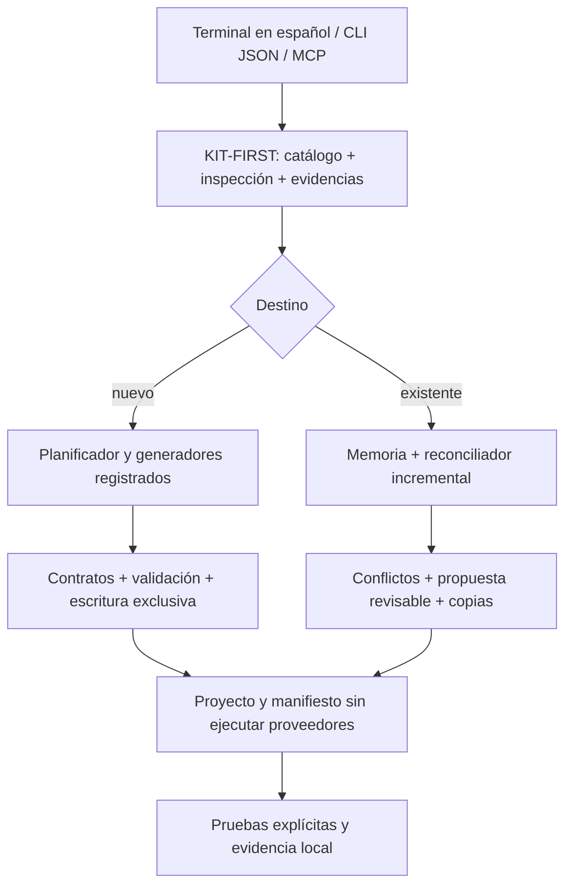

# Arquitectura del kit y puntos de extensión

## Reutilización

`scripts/kit-first` publica catálogos y une evidencia a versión/contenido del kit y destino. Una evidencia de otra carpeta, incompleta o caducada bloquea generación. `scripts/terminal` transforma requisitos en datos validados; un proveedor opcional no puede devolver comandos ejecutables. `scripts/agents` expone el mismo servicio en API CommonJS/MCP, con descubrimiento y validación previos por conexión. No controla escrituras ajenas a estas interfaces.

`scripts/composition` selecciona módulos/arquetipos y generadores confiables. Los catálogos JSON son declarativos, nunca ejecutan código. Cada generador declara capacidades/lenguaje/frameworks/bases y puede tener validación específica para API o artefactos no HTTP. Los contratos permiten implementar límites en otros lenguajes sin migraciones forzadas; registrarlos no crea esos adaptadores automáticamente.

Generadores ejecutables actuales: `node-sqlite` (comercio/CRM v1, modular o servicios), `python-inventory` (SQLite o JSON-file), `node-business-v2` (CRM/SaaS/combinaciones, modular). Los otros starters de versiones y backends /health continúan separados: un starter no equivale a aplicación de negocio completa.

Business v2 envuelve comercio existente detrás de una única autoridad de credenciales por actor. Las credenciales internas de la adaptación son efímeras en memoria. Reutiliza contacto/mensaje/inbox; agrega tablas con claves compuestas por empresa y puertos separados de canales/IA. No cambia el código runtime v1 ni su esquema; bases v1 se bloquean al intentar adopción v2 sin migración específica.

`scripts/memory` conserva manifiesto inicial y revisiones encadenadas, archivos/propiedad, módulos, procedencia, contratos, decisiones y estado real de verificación. El reconciliador actual modifica solo composiciones v1 compatibles con archivos de origen intactos; preserva documentos personalizados y bloquea fuentes modificadas/cambios de familia. Business v2, Python y proyectos ajenos requieren reconciliadores específicos para cambios incrementales: se pueden inspeccionar/adoptar, no regenerar encima.

`scripts/commercial` registra paquetes y combinaciones, sin confundir generación local con producto comercial certificado. `scripts/commands`, `scripts/docker`, `scripts/tools` y `scripts/workspace` se reutilizan para recetas, Compose, diagnósticos y comandos manuales. Ninguna generación ejecuta instalaciones o Docker.

## Extender

1. Agregar datos versionados y validados al catálogo; referencias con revisión/licencia/procedencia.
2. Registrar un adaptador de código confiable con capacidades y validación reales.
3. Implementar archivos y pruebas ejecutables antes de ampliar estados comerciales.
4. Añadir vocabulario declarativo y pruebas positivas/negativas de idioma y conflictos.
5. Implementar reconciliador específico antes de permitir ampliación en proyectos existentes.
6. Actualizar documentación y evidencia, dejando canales no verificados deshabilitados.

No hay soporte universal certificado de frameworks por reconocer sus nombres. No se selecciona un stack sustituto cuando falta un generador compatible.
