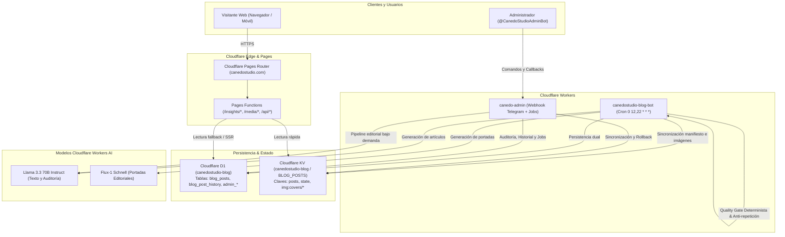

# Canedo Studio — Documentación Técnica de Arquitectura, Automatismos y Operaciones

Documento técnico maestro que refleja el estado real del ecosistema en producción, automatizaciones de Cloudflare Workers, base de datos D1, KV, administración por Telegram y procedimientos operativos.

---

## 1. Arquitectura del Sistema



---

## 2. Tecnologías y Componentes de Producción

| Tecnología | Rol / Implementación | Estado |
|---|---|---|
| **Cloudflare Pages** | Aloja el frontend estático y dinámico de `canedostudio.com`. | **Producción activa** (`c0480879-88c9-4089-a2e6-a076735e5812`). |
| **Cloudflare Pages Functions** | SSR para `/insights/[slug]`, entrega de imágenes en `/media/[[path]]` y APIs. | **Producción activa** (enrutamiento nativo sin build step pesado). |
| **Cloudflare Workers** | Microservicios desacoplados: `canedostudio-blog-bot` (v. `ee5babb0-e9cb-4a13-b9a2-d500490f136b`) y `canedo-admin` (v. `9f19e8c3-bb5a-47f8-be76-d8cdec755706`). | **Producción activa** con versiones auditadas en Wrangler. |
| **Cloudflare D1** | Base de datos SQL relacional SQLite distribuida (`canedostudio-blog`, ID: `d083c7a5-a0fc-4e84-8dd5-d3bb278ccdf0`). | **Fuente canónica de verdad** (76 artículos publicados). |
| **Cloudflare KV** | Almacenamiento clave-valor de baja latencia (`canedostudio-blog`, ID: `1a3b08427d144d51af218578387e09b5`). | **Búfer de lectura y caché** para `posts`, `state` e `img:covers/*`. |
| **Workers AI** | `@cf/meta/llama-3.3-70b-instruct-fp8-fast` y `@cf/black-forest-labs/flux-1-schnell`. | **Activo** con gestión estricta de cuotas y contingencias. |
| **Telegram Bot API** | Bot de administración `@CanedoStudioAdminBot` y canal de alertas de contacto `@CanedoContactoBot`. | **Operativo** con callbacks compactos (< 64 bytes). |

---

## 3. Estado de Páginas y Funcionalidades de la Web (`canedostudio.com`)

- **Inicio (`/`):** Hero, Bento Grid de propuesta de valor, stack tecnológico y llamada a diagnóstico.
- **Servicios:**
  - `/servicios/diseno-web`: Diseño web de alta conversión y dark luxury.
  - `/servicios/chatbots-ia`: Chatbots comerciales entrenados con datos del negocio.
  - `/servicios/automatizacion-resenas`: Embudos de reseñas y reputación en Google Maps.
  - `/servicios/blog-automatizado`: Solución de blog editorial autogestionado con IA.
- **Insights / Blog (`/blog` e `/insights/[slug]`):**
  - Renderizado dinámico con tabla de contenidos (`.toc-card`), sidebar flotante (`.post-editorial-sidebar`), resumen BLUF y Schema.org BlogPosting.
  - Layout restaurado a `max-width: 1200px` con portada responsive en `height: auto; object-fit: contain;`.
- **Contacto (`/contacto.html`):** Formulario activo en modo `TELEGRAM_ONLY` con validación antispam y selección múltiple de servicios.
- **Nosotros (`/nosotros`) y Casos (`/casos`):** Páginas institucionales y casos de estudio.
- **Sistema de Calificación Oculto (`/calificanos.html`):** Embudo que desvía 4-5 estrellas a Google y las inferiores a feedback privado.

---

## 4. Blog Bot Automático (`canedostudio-blog-bot`)

- **Disparador:** Cron programado `0 12,22 * * *` (7:00 a. m. y 5:00 p. m. hora Colombia, UTC-5).
- **Quality Gate Editorial y Antirrepetición:**
  - **Detector determinista de oraciones duplicadas:** Función `checkDuplicateSentences` en `duplicate_checker.js` (0 costo, 0 llamadas a IA). Bloquea oraciones sustanciales ($\ge 6$ palabras, $\ge 30$ caracteres) repetidas entre bloques sin falsos positivos en citas ni encabezados.
  - **Sanitización seccional:** `sanitizeCrossSectionDuplicates` elimina puentes transicionales idénticos entre secciones consecutivas durante la generación.
  - **Filtro contra afirmaciones cuantitativas no respaldadas:** Bloqueo regex determinista contra porcentajes y cifras inventadas.
  - **Calibración de extensión:** Límites de 650 a 900 palabras en cuerpo editorial para artículos estándar.
- **Prompts visuales curados (`topics.js`):** Enfocados exclusivamente en interfaces web digitales, monitores dark mode y analítica SaaS, eliminando metáforas de papelería física (tarjetas de visita o placas).
- **Pruebas automatizadas:** **76 de 76 pruebas aprobadas** (`node --test tests/*.test.mjs`), cubriendo resiliencia, horarios UTC, portadas de contingencia y prevención de duplicados.

---

## 5. Canedo Admin — Telegram Bot (`canedo-admin`)

- **Listado y Navegación:** Paginación de 5 en 5 artículos con botones inline interactivos.
- **Gestión de Artículos:**
  - Consulta de artículos en estado `published` y `unpublished`.
  - Despublicación segura (cambio de estado en D1 a `unpublished` y remoción limpia del manifiesto KV `posts`).
  - Restauración (retorno a `published` y reintegración en KV con historial de rollback).
  - Edición granular (título, resumen, metadatos y bloques de texto).
- **Identificadores compactos:** Resuelve la limitación de 64 bytes UTF-8 de Telegram usando IDs numéricos (`blog:e:t:75`), garantizando compatibilidad retroactiva.
- **Pruebas automatizadas:** **58 de 58 pruebas aprobadas** en `canedo-admin/tests/`.

---

## 6. Correcciones Críticas de Producción

### A. Reparación Editorial y Portada del Artículo 75
- **Artículo:** ID `75` | Slug: `diseno-que-da-seguridad`.
- **Corrección editorial:** Eliminación en D1 y KV de dos oraciones duplicadas en el bloque 7 que repetían textualmente el cierre del bloque 4.
- **Nueva portada versionada:** Para evitar problemas con la caché inmutable de Cloudflare (`max-age=31536000`), se publicó `diseno-que-da-seguridad-v2.jpg` (289 KB, monitor con interfaz dark mode completa) en la clave KV `img:covers/diseno-que-da-seguridad-v2.jpg`, actualizando la referencia `cover_url` en D1.
- **Respaldos permanentes:** Almacenados en `backup_post_75/` con scripts de rollback granular.

### B. Corrección del CSS de Portadas y Restauración de Ancho
- **Incidencia:** El despliegue inicial `48976caa` aplicó un CSS que redujo `.post-body` a 720 px e invisibilizó el sidebar.
- **Solución implementada:** Se restauró la estructura original completa de producción (`max-width: 1200px`, `.post-editorial-wrap` de 2 columnas con sidebar de 320 px) y se aplicó la regla no destructiva a las imágenes:
  ```css
  .post-body .post-cover img {
    width: 100%;
    height: auto;
    object-fit: contain;
    display: block;
  }
  ```
- **Versión activa en producción:** Despliegue Cloudflare Pages `c0480879-88c9-4089-a2e6-a076735e5812`.

---

## 7. Canedo Contacto — Preparación de Fase 4 (Contacto + CRM)

- **Estado técnico actual:**
  - Formulario público en `/contacto.html` con envío asíncrono a `/api/contact`.
  - Modo operativo `TELEGRAM_ONLY`: alertas instantáneas en grupo privado de Telegram mediante `@CanedoContactoBot`.
  - D1 Database: Esquema de base de datos preparado con retención de datos durante 180 días (sujeta a retenciones legales y contractuales documentadas) y limpieza técnica periódica de 30 días.
  - Protección antispam mediante honeypot (`_honey`) y rate limiting atómico en D1.
  - Módulo Resend desacoplado para envío de correos cuando se active en el CRM.
- **Pruebas automatizadas:** **69 de 69 pruebas aprobadas** en `cazas/canedostudio.com/tests/contact/`.

---

## 8. Roadmap de Fases Siguientes

| Fase | Denominación | Objetivo | Dependencias | Estado |
|---|---|---|---|---|
| **Fase 4** | **Canedo Contacto + CRM Comercial** | Centralización de prospectos en panel de Telegram, calificación automática de leads y pipeline de ventas. | D1 Contacto, Telegram Bot API | **En preparación (listo para arrancar)** |
| **Fase 5** | **Canedo Prospector IA** | Detección automatizada de oportunidades y auditorías web previas a la venta. | Workers AI, Scraping ético | Pendiente |
| **Fase 6** | **Canedo Monitor** | Supervisión continua de uptime, rendimiento Lighthouse e integridad D1/KV. | Cron triggers, alertas Telegram | Pendiente |
| **Mejoras** | **Gestión Comercial por Telegram** | Edición de catálogo de servicios, precios y enlaces de agenda desde el bot. | Canedo Admin | En diseño |

---

## 9. Seguridad, Operaciones y Respaldos

- **Secretos:** Gestionados exclusivamente mediante variables de entorno en Cloudflare Workers y Pages (`wrangler secret put`). Prohibido versionar tokens en Git.
- **Fuente de Verdad:** Cloudflare D1 es la única fuente de verdad; KV opera como caché de aceleración y búfer de lectura estática.
- **Respaldos antes de escribir:** Toda actualización en D1 o KV genera un snapshot JSON descargable con timestamp antes de ejecutar la mutación.
- **Rollback desacoplado:** Disponibilidad de scripts quirúrgicos en Node.js que revierten filas específicas de D1 y entradas de KV sin sobreescribir datos concurrentes generados por el bot.

---

## 10. Reglas Obligatorias para Futuros Despliegues

Para evitar regresiones visuales o sobreescritura de archivos antiguos:
1. **Identificar la versión activa:** Consultar el ID de despliegue activo en Cloudflare Pages (`wrangler pages project list` o API).
2. **Comparar producción contra local:** Extraer el asset público de producción (ej. `curl https://canedostudio.com/styles.css`) y compararlo con el archivo local antes de modificar.
3. **Compilación limpia obligatoria:** Utilizar siempre `node cazas/canedostudio.com/scripts/build_clean_deployment.mjs` para garantizar que la carpeta `dist_production_clean` contenga exactamente los archivos actuales.
4. **Despliegue selectivo:** Desplegar Pages únicamente desde `dist_production_clean/public`.
5. **Verificación inmediata:** Comprobar HTTP 200 y la presencia de las reglas esperadas en el dominio público inmediatamente después de desplegar.

