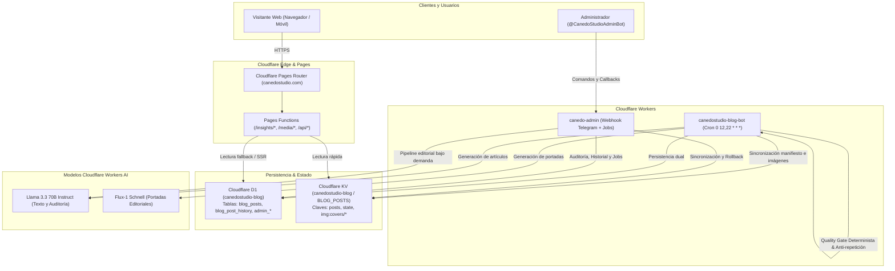

# Canedo Studio — Documentación Técnica de Arquitectura, Automatismos y Operaciones

Documento técnico maestro que refleja el estado real del ecosistema en producción, automatizaciones de Cloudflare Workers, base de datos D1, KV, administración por Telegram y procedimientos operativos.

---

## 1. Arquitectura del Sistema



---

## 2. Tecnologías y Componentes de Producción

| Tecnología | Rol / Implementación | Estado |
|---|---|---|
| **Cloudflare Pages** | Aloja el frontend estático y dinámico de `canedostudio.com`. | **Producción activa** (`c0480879-88c9-4089-a2e6-a076735e5812`). |
| **Cloudflare Pages Functions** | SSR para `/insights/[slug]`, entrega de imágenes en `/media/[[path]]` y APIs. | **Producción activa** (enrutamiento nativo sin build step pesado). |
| **Cloudflare Workers** | Microservicios desacoplados: `canedostudio-blog-bot` (v. `ee5babb0-e9cb-4a13-b9a2-d500490f136b`) y `canedo-admin` (v. `9f19e8c3-bb5a-47f8-be76-d8cdec755706`). | **Producción activa** con versiones auditadas en Wrangler. |
| **Cloudflare D1** | Base de datos SQL relacional SQLite distribuida (`canedostudio-blog`, ID: `d083c7a5-a0fc-4e84-8dd5-d3bb278ccdf0`). | **Fuente canónica de verdad** (76 artículos publicados). |
| **Cloudflare KV** | Almacenamiento clave-valor de baja latencia (`canedostudio-blog`, ID: `1a3b08427d144d51af218578387e09b5`). | **Búfer de lectura y caché** para `posts`, `state` e `img:covers/*`. |
| **Workers AI** | `@cf/meta/llama-3.3-70b-instruct-fp8-fast` y `@cf/black-forest-labs/flux-1-schnell`. | **Activo** con gestión estricta de cuotas y contingencias. |
| **Telegram Bot API** | Bot de administración `@CanedoStudioAdminBot` y canal de alertas de contacto `@CanedoContactoBot`. | **Operativo** con callbacks compactos (< 64 bytes). |

---

## 3. Estado de Páginas y Funcionalidades de la Web (`canedostudio.com`)

- **Inicio (`/`):** Hero, Bento Grid de propuesta de valor, stack tecnológico y llamada a diagnóstico.
- **Servicios:**
  - `/servicios/diseno-web`: Diseño web de alta conversión y dark luxury.
  - `/servicios/chatbots-ia`: Chatbots comerciales entrenados con datos del negocio.
  - `/servicios/automatizacion-resenas`: Embudos de reseñas y reputación en Google Maps.
  - `/servicios/blog-automatizado`: Solución de blog editorial autogestionado con IA.
- **Insights / Blog (`/blog` e `/insights/[slug]`):**
  - Renderizado dinámico con tabla de contenidos (`.toc-card`), sidebar flotante (`.post-editorial-sidebar`), resumen BLUF y Schema.org BlogPosting.
  - Layout restaurado a `max-width: 1200px` con portada responsive en `height: auto; object-fit: contain;`.
- **Contacto (`/contacto.html`):** Formulario activo en modo `TELEGRAM_ONLY` con validación antispam y selección múltiple de servicios.
- **Nosotros (`/nosotros`) y Casos (`/casos`):** Páginas institucionales y casos de estudio.
- **Sistema de Calificación Oculto (`/calificanos.html`):** Embudo que desvía 4-5 estrellas a Google y las inferiores a feedback privado.

---

## 4. Blog Bot Automático (`canedostudio-blog-bot`)

- **Disparador:** Cron programado `0 12,22 * * *` (7:00 a. m. y 5:00 p. m. hora Colombia, UTC-5).
- **Quality Gate Editorial y Antirrepetición:**
  - **Detector determinista de oraciones duplicadas:** Función `checkDuplicateSentences` en `duplicate_checker.js` (0 costo, 0 llamadas a IA). Bloquea oraciones sustanciales ($\ge 6$ palabras, $\ge 30$ caracteres) repetidas entre bloques sin falsos positivos en citas ni encabezados.
  - **Sanitización seccional:** `sanitizeCrossSectionDuplicates` elimina puentes transicionales idénticos entre secciones consecutivas durante la generación.
  - **Filtro contra afirmaciones cuantitativas no respaldadas:** Bloqueo regex determinista contra porcentajes y cifras inventadas.
  - **Calibración de extensión:** Límites de 650 a 900 palabras en cuerpo editorial para artículos estándar.
- **Prompts visuales curados (`topics.js`):** Enfocados exclusivamente en interfaces web digitales, monitores dark mode y analítica SaaS, eliminando metáforas de papelería física (tarjetas de visita o placas).
- **Pruebas automatizadas:** **76 de 76 pruebas aprobadas** (`node --test tests/*.test.mjs`), cubriendo resiliencia, horarios UTC, portadas de contingencia y prevención de duplicados.

---

## 5. Canedo Admin — Telegram Bot (`canedo-admin`)

- **Listado y Navegación:** Paginación de 5 en 5 artículos con botones inline interactivos.
- **Gestión de Artículos:**
  - Consulta de artículos en estado `published` y `unpublished`.
  - Despublicación segura (cambio de estado en D1 a `unpublished` y remoción limpia del manifiesto KV `posts`).
  - Restauración (retorno a `published` y reintegración en KV con historial de rollback).
  - Edición granular (título, resumen, metadatos y bloques de texto).
- **Identificadores compactos:** Resuelve la limitación de 64 bytes UTF-8 de Telegram usando IDs numéricos (`blog:e:t:75`), garantizando compatibilidad retroactiva.
- **Pruebas automatizadas:** **58 de 58 pruebas aprobadas** en `canedo-admin/tests/`.

---

## 6. Correcciones Críticas de Producción

### A. Reparación Editorial y Portada del Artículo 75
- **Artículo:** ID `75` | Slug: `diseno-que-da-seguridad`.
- **Corrección editorial:** Eliminación en D1 y KV de dos oraciones duplicadas en el bloque 7 que repetían textualmente el cierre del bloque 4.
- **Nueva portada versionada:** Para evitar problemas con la caché inmutable de Cloudflare (`max-age=31536000`), se publicó `diseno-que-da-seguridad-v2.jpg` (289 KB, monitor con interfaz dark mode completa) en la clave KV `img:covers/diseno-que-da-seguridad-v2.jpg`, actualizando la referencia `cover_url` en D1.
- **Respaldos permanentes:** Almacenados en `backup_post_75/` con scripts de rollback granular.

### B. Corrección del CSS de Portadas y Restauración de Ancho
- **Incidencia:** El despliegue inicial `48976caa` aplicó un CSS que redujo `.post-body` a 720 px e invisibilizó el sidebar.
- **Solución implementada:** Se restauró la estructura original completa de producción (`max-width: 1200px`, `.post-editorial-wrap` de 2 columnas con sidebar de 320 px) y se aplicó la regla no destructiva a las imágenes:
  ```css
  .post-body .post-cover img {
    width: 100%;
    height: auto;
    object-fit: contain;
    display: block;
  }
  ```
- **Versión activa en producción:** Despliegue Cloudflare Pages `c0480879-88c9-4089-a2e6-a076735e5812`.

---

## 7. Canedo Contacto — Fase 4: Contacto + CRM Comercial

### A. Infraestructura Base Implementada y Verificada
- **Formulario público:** Captura accesible en `/contacto.html` y endpoint `/api/contact` (Pages Functions).
- **Modo operativo:** `TELEGRAM_ONLY` (notificaciones inmediatas al chat de operaciones vía `@CanedoContactoBot`).
- **Persistencia y retención:** Cloudflare D1 (`canedostudio-contact-production`). Retención programada de 180 días con soporte de congelamiento legal/contractual (`contact_retention_holds`) y limpieza técnica de 30 días.
- **Seguridad y antispam:** Honeypot (`_honey`), rate limiting atómico HMAC SHA-256 en D1 (5 solicitudes / 10 min por IP), validación de origen estricta y protección de idempotencia por UUID/fingerprint.

### B. Fase 4B — Preparación Local del CRM Pipeline (Completada Localmente)
- **Migración D1:** `cazas/canedostudio.com/migrations/contact/0005_crm_pipeline.sql` diseñada y validada localmente.
  - `contact_crm_status`: Estados comerciales (`nuevo`, `contactado`, `en_calificacion`, `propuesta_enviada`, `ganado`, `archivado`), prioridad (`baja`, `media`, `alta`, `urgente`), valor estimado y el identificador compacto numérico `lead_num` para interacción segura en Telegram (< 64 bytes).
  - `contact_crm_history`: Auditoría inmutable de transiciones y cambios comerciales.
  - `contact_crm_notes`: Bitácora de seguimiento (llamadas, reuniones, propuestas).
  - `contact_crm_reminders`: Próximas acciones comerciales con fechas de vencimiento.
- **Trigger atómico:** Al registrarse un lead (`contact_requests`), se crea en la misma transacción su entrada en el embudo comercial (`contact_crm_status` en estado `nuevo`) preservando el rate limiting y el outbox de notificaciones sin duplicación.
- **Cascada de retención limpia:** Todas las tablas secundarias del CRM poseen `ON DELETE CASCADE` referenciando `contact_requests(id)`. Si un prospecto expira tras 180 días, sus notas e historial se purgan atómicamente sin dejar datos personales (PII) huérfanos.
- **Servicio y Pruebas:** Implementado `cazas/canedostudio.com/lib/contact/crm-service.mjs` y suite `crm-pipeline.test.mjs`. **76 de 76 pruebas aprobadas** en local (68 base + 8 CRM).
- **Estado de despliegue:** **Exclusivamente local**. No se ha ejecutado migración en el D1 remoto de producción.

### C. Fase 4C, 4D y 4E — Módulo CRM, Recordatorios Comerciales y Navegación en Telegram (Canedo Admin)
- **Separación Limpia de Triggers D1:**
  - El trigger original `contact_request_created` permanece intacto para la gestión exclusiva de cuotas (`contact_rate_limits`) y outbox (`contact_notifications`).
  - Se implementó el trigger dedicado `contact_crm_initialized` en la migración `0005_crm_pipeline.sql` para inicializar el estado comercial `nuevo` y asignar `lead_num` sin duplicar cuotas ni notificaciones.
- **Controlador e Interfaces:**
  - Implementado `automatismos/canedo-admin/src/modules/crm/service.js` y `ui.js` para gestión comercial desde Telegram (@CanedoStudioAdminBot).
  - Conexión preparada para binding secundario `CONTACT_DB` en D1 (sin modificar el binding principal `BLOG_DB`).
- **Navegación Unificada y Corrección de 'Volver al Menú Principal' (Fase 4E):**
  - Se identificó y resolvió la causa raíz del enrutamiento de `menu:main`: no existía manejador específico en el webhook, provocando que se tratara como un callback desconocido sin editar la interfaz.
  - Implementado el manejador directo para `menu:main`: limpia estados conversacionales residuales en KV (`user_state:<admin_userId>`), responde con `answerCallbackQuery`, edita el mensaje al menú principal y posee fallback con `sendTelegramMessage` si el mensaje original no permite edición.
- **Comandos de Telegram:**
  - `/leads`: Menú interactivo con el conteo de leads por estado y botones de filtrado rápido.
  - `/lead <numero>`: Vista detallada del prospecto, datos de contacto, requerimiento, prioridad, recordatorios y notas.
  - `/pipeline`: Visión integral de conversión con prospectos ganados y valor estimado acumulado.
- **Botones Interactivos Compactos (< 64 bytes):**
  - Cambios de estado inmediatos: `crm:s:c:<num>` (contactado), `crm:s:q:<num>` (en calificación), `crm:s:p:<num>` (propuesta enviada), `crm:s:g:<num>` (ganado), `crm:s:a:<num>` (archivado), `crm:s:n:<num>` (nuevo).
  - Consulta y navegación paginada: `crm:v:<num>` (ver prospecto), `crm:list:<offset>:<status>`.
  - Prompts conversacionales aislados: `crm:note_prompt:<num>` (registro de nota en bitácora) y `crm:rem_prompt:<num>` (programación de recordatorio con días de vencimiento).
  - Resolución de recordatorios: `crm:rem_done:<remId>` (marcar completado) y `crm:rem_postpone:<remId>:<dias>` (posponer recordatorio).
- **Cron de Recordatorios Comerciales (Fase 4D):**
  - Reutilización del cron trigger de `canedo-admin` (`* * * * *`).
  - Proceso atómico `claimDueReminders`: reserva exclusiva mediante arrendamiento temporal (`lease_until`), token de intento (`attempt_token`) y control de reintentos (`attempts < 3`), garantizando cero mensajes duplicados en Workers concurrentes.
  - Filtro estricto de retención: ignora automáticamente recordatorios de prospectos expirados (`expires_at <= now` o `state <> 'saved'`).
- **Seguridad y Autorización:**
  - Validación obligatoria de lista blanca de administradores (`ALLOWED_ADMIN_IDS`) en todas las operaciones del CRM.
  - Cero exposición de datos PII en respuestas genéricas o logs.
- **Pruebas Automatizadas:** **16 de 16 suites aprobadas** en regresión total del sistema (76 pruebas de Contacto/CRM + 79 pruebas de Canedo Admin = 155 pruebas aprobadas).
- **Estado de despliegue:** **OPERATIVO EN PRODUCCIÓN**.
  - Versión activa de `canedo-admin`: `b969a639-44c2-4b04-95b5-585634bed9ef` (desplegada el 2026-11-16).
  - Binding secundario activo: `CONTACT_DB` (`canedostudio-contact-production`).
  - Webhook de administración: Activo en `@CanedoStudioAdminBot`.
  - Cron trigger: Activo en `* * * * *` (recuperación de jobs y recordatorios CRM).

---

## 8. Módulo Editorial de YouTube y Enfoques Multi-Formato (Fases D1 a D5)

Sistema local de ingesta, auditoría, procesamiento editorial y renderizado de videos de YouTube integrado en Canedo Admin y Cloudflare Pages:

- **Ingesta Segura (D2):**
  - Validador estricto de URLs y Video IDs de YouTube (`parseAndValidateYouTubeUrl`).
  - Cliente oEmbed con límites de payload y comprobación de embeddability (`fetchYouTubeMetadata`).
  - Detección de duplicados en D1 (`blog_posts` y `blog_manual_drafts`).
- **Pipeline Editorial con IA (D3):**
  - Sanitización anti-prompt injection de transcripciones y notas de contexto (`sanitizeSourceText`).
  - Quality Gate específico de YouTube (`auditYouTubeArticle`) con verificación de bloque embebido, extensión 400-1.600 palabras, encabezados H2 y atribución al canal.
  - Soporte de 3 enfoques editoriales: `informativo`, `comercial` (relacionado con servicios de Canedo Studio sin venta agresiva) y `tecnico` (arquitectura y buenas prácticas).
- **Renderizado SSR Seguro (D4):**
  - Bloque `youtube_embed` en `functions/insights/[slug].js`.
  - Reproductor embebido con `youtube-nocookie.com`, `loading="lazy"`, `referrerpolicy="strict-origin-when-cross-origin"` y relación nativa 16:9 (`aspect-ratio: 16/9`).
  - Atribución visible con validación estricta de dominios de YouTube en `authorUrl` y `canonicalUrl` con `rel="noopener noreferrer nofollow"`.
  - Schema.org con `@type: "VideoObject"` estructurado cuando el post contiene video verificado.
- **Integración con Telegram y Bot Admin (D5):**
  - Botón `🎥 Crear desde YouTube` en el menú del blog.
  - Detección directa de enlaces de YouTube recibidos en mensajes de chat (sin colisionar con otros flujos).
  - Máquina de estados conversacionales en KV (`awaiting_yt_url`, `awaiting_yt_context`, `awaiting_yt_angle`) con expiración de 600s.
  - Reutilización integral de jobs asíncronos (`blog_generate_youtube_draft`), cola de fondo y botones de gestión estándar (`Aprobar`, `Modificar`, `Regenerar`, `Descartar`).

---

## 9. Módulo de Investigación Editorial Multifuente (Fases E y V1-X/V1-Z)

### A. Fase E1 — Extractor Web Resiliente y Seguro
- **Ubicación:** `automatismos/canedo-admin/src/modules/research/web_extractor.js`.
- **Propósito:** Ingesta y análisis seguro de enlaces web externos (blogs, noticias, artículos) para alimentar el pipeline editorial de investigación de Workers AI.
- **Validación de URLs y Controles Anti-SSRF:**
  - Protocolo exclusivo `https:`. Rechazo inmediato de credenciales (`user:pass@host`).
  - Filtrado de `localhost`, dominios locales (`.local`, `.internal`) y endpoints de metadatos cloud (`169.254.169.254`, `metadata.google.internal`).
  - Bloqueo de rangos IPv4 privados (RFC1918 clase A, B, C, loopback, link-local) e IPv6 (`::1`, `fe80::`, `fc00::`).
  - Intercepción manual de redirecciones (`redirect: "manual"`): cada salto HTTP 301/302 se revalida contra las políticas anti-SSRF antes de continuar (máximo 3 redirecciones).
- **Control de Descarga y Consumo de Recursos:**
  - Timeout configurable mediante `AbortController` (por defecto 7.000 ms).
  - Límite de descarga mediante lectura de `ReadableStream` (`getReader()`), cancelando la conexión si el cuerpo supera los 512 KB.
  - Verificación estricta de cabecera `Content-Type` admitiendo únicamente `text/html` y `application/xhtml+xml`.
- **Extracción Semántica y Limpieza Editorial:**
  - Extracción de metadatos OpenGraph, Schema.org y tags estándar (título, autor, fecha de publicación, canonical, siteName).
  - Remoción de código y ruido no editorial (`<script>`, `<style>`, `<svg>`, `<form>`, `<nav>`, `<header>`, `<footer>`, `<aside>`).
  - Priorización del contenedor semántico `<article>` o `<main>`. Deduplicación de párrafos repetidos.
  - Sanitización contra prompt injection: neutralización de delimitadores de código (``` a ''') y supresión de etiquetas pseudoinstructivas (`<system>`, `<prompt>`, `<instruction>`).

### B. Fases V1-X y V1-Z — «🔗 Crear desde Enlace Web» en Canedo Admin
- **Ubicación:** `automatismos/canedo-admin/src/modules/blog/web_pipeline.js` e integración en `src/index.js`.
- **Flujo de Usuario en Telegram:**
  1. Menú Blog: Botón `🔗 Crear desde Enlace Web` (`blog:create_web`).
  2. Estado KV `awaiting_web_url` (expira en 600s): El bot solicita la URL al admin.
  3. Extracción y análisis: Extracción asíncrona segura con `web_extractor.js`. Detección automática de duplicados contra artículos ya publicados en D1 (`blog_posts`) y borradores en curso (`blog_manual_drafts`).
  4. Estado KV `awaiting_web_angle`: Presentación de metadatos extraídos y selección de enfoque editorial (`Informativo`, `Comercial Canedo`, `Técnico`).
  5. Encolado de Job Asíncrono en D1: Registro en `admin_jobs` con tipo `blog_generate_web_draft`.
  6. Procesamiento en segundo plano (`processBlogDraftJob`): Generación editorial mediante Llama 3.3 70B, Quality Gate determinista (`auditArticle`), y persistencia como borrador en `blog_manual_drafts`.
  7. Presentación y Decisión Humana: Notificación en Telegram al administrador con resumen, auditoría de calidad y teclado interactivo para Aprobación/Edición/Rechazo.
- **Idempotencia y Resiliencia en D1 (V1-Z):**
  - Generación determinista de `draftId` a partir de `jobId` (`draft_` + `jobId.replace(/^job_/, '')`).
  - Persistencia segura con cláusula `ON CONFLICT(id) DO UPDATE SET title=excluded.title, content_json=excluded.content_json, brief_json=excluded.brief_json, audit_json=excluded.audit_json, word_count=excluded.word_count, updated_at=CURRENT_TIMESTAMP`.
  - Si un job es reintentado o recuperado tras reinicio del Worker (`recoverInterruptedJobs`), no se crean borradores duplicados ni ocurren violaciones de clave única.

---

## 10. Roadmap de Fases Siguientes

| Fase | Denominación | Objetivo | Dependencias | Estado |
|---|---|---|---|---|
| **Fase 4** | **Canedo Contacto + CRM Comercial** | Centralización de prospectos en panel de Telegram, calificación automática de leads y pipeline de ventas. | D1 Contacto, Telegram Bot API | **En preparación (listo para arrancar)** |
| **Fase 5** | **Canedo Prospector IA** | Detección automatizada de oportunidades y auditorías web previas a la venta. | Workers AI, Scraping ético | Pendiente |
| **Fase 6** | **Canedo Monitor** | Supervisión continua de uptime, rendimiento Lighthouse e integridad D1/KV. | Cron triggers, alertas Telegram | Pendiente |
| **Mejoras** | **Gestión Comercial por Telegram** | Edición de catálogo de servicios, precios y enlaces de agenda desde el bot. | Canedo Admin | En diseño |

---

## 9. Seguridad, Operaciones y Respaldos

- **Secretos:** Gestionados exclusivamente mediante variables de entorno en Cloudflare Workers y Pages (`wrangler secret put`). Prohibido versionar tokens en Git.
- **Fuente de Verdad:** Cloudflare D1 es la única fuente de verdad; KV opera como caché de aceleración y búfer de lectura estática.
- **Respaldos antes de escribir:** Toda actualización en D1 o KV genera un snapshot JSON descargable con timestamp antes de ejecutar la mutación.
- **Rollback desacoplado:** Disponibilidad de scripts quirúrgicos en Node.js que revierten filas específicas de D1 y entradas de KV sin sobreescribir datos concurrentes generados por el bot.

---

## 10. Reglas Obligatorias para Futuros Despliegues

Para evitar regresiones visuales o sobreescritura de archivos antiguos:
1. **Identificar la versión activa:** Consultar el ID de despliegue activo en Cloudflare Pages (`wrangler pages project list` o API).
2. **Comparar producción contra local:** Extraer el asset público de producción (ej. `curl https://canedostudio.com/styles.css`) y compararlo con el archivo local antes de modificar.
3. **Compilación limpia obligatoria:** Utilizar siempre `node cazas/canedostudio.com/scripts/build_clean_deployment.mjs` para garantizar que la carpeta `dist_production_clean` contenga exactamente los archivos actuales.
4. **Despliegue selectivo:** Desplegar Pages únicamente desde `dist_production_clean/public`.
5. **Verificación inmediata:** Comprobar HTTP 200 y la presencia de las reglas esperadas en el dominio público inmediatamente después de desplegar.

